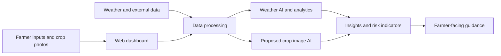

# 🌱 AGRIVISION AI
### AI-Powered Precision Agriculture & Climate Intelligence Platform

**HackOverflow 10.0 | Open Innovation Track**  
**Team: Innovation Insurgents**  
**Members: Om Rane · Sudiksha Sawant**

**🚀 [Launch Agrivision AI](https://agrivision-cyan-two.vercel.app/)**

---

## 🌾 About the Project

**Agrivision AI** is a web-based agricultural decision-support platform that brings together weather forecasting, climate insights, and data visualization to help farmers interpret changing environmental conditions. The expanded hackathon vision adds crop disease screening, soil and irrigation guidance, crop recommendations, and an agricultural AI assistant to create a unified smart-farming experience.

## 🎯 Problem Statement

Farmers face unpredictable weather, crop diseases, limited access to personalized agronomic guidance, and fragmented sources of information. Agrivision AI aims to bring relevant information and decision-support tools into one accessible platform.

## ✨ Features

### Existing project foundation
- **Weather intelligence dashboard** — View forecast and environmental conditions.
- **Weather analytics and visualization** — Explore trends and interactive weather maps.
- **Multi-source weather data** — Integrates weather information such as Open-Meteo and NASA POWER in the project workflow.
- **AI/ML weather experimentation** — Forecast evaluation and prediction analysis.

### Proposed / evolving hackathon expansion
> **Development note:** The capabilities below are part of the proposed product roadmap. Do not treat them as deployed or validated until implemented and tested.

- **📷 Crop Disease Detection** — Upload leaf images for AI-assisted disease screening and confidence reporting.
- **🌱 Crop Recommendations** — Suggest crop choices using available season, location, soil and weather inputs.
- **🧪 Soil Health Intelligence** — Interpret soil pH and nutrient data when supplied.
- **💧 Smart Irrigation Advisor** — Recommend irrigation planning based on forecast and soil inputs.
- **⚠️ Pest & Disease Risk Alerts** — Surface environmental conditions linked to elevated agricultural risk.
- **🤖 Farmer AI Assistant** — Multilingual answers to common agricultural questions.
- **📈 Yield & Farm Analytics** — Longer-term exploration of crop performance and yield estimates.

## 🔄 How It Works

## 🧰 Technology Overview

The project combines a web interface with external weather data and analytical services. Technologies used or considered for the expanded architecture include:

| Layer | Technologies / approach |
|---|---|
| Web interface | React / Next.js-style dashboard, interactive maps and charts |
| Data sources | Open-Meteo, NASA POWER, supported weather and radar sources |
| AI & analytics | Python-based forecasting and evaluation; proposed CNN/image classifier |
| API services | Backend integrations and API endpoints |
| Deployment | Vercel-hosted live website |
| Future storage | Database for farm profiles, prediction history and crop records |

> Verify the exact repository dependencies and implementation before claiming a specific library, database, or model is already deployed.

## 🌍 Who Benefits?

- Small and medium-scale farmers seeking accessible weather information.
- Agricultural extension workers and cooperatives supporting farm decisions.
- AgriTech teams exploring AI-assisted farm monitoring.
- Rural communities that benefit from clearer climate-risk information.

## 🚧 Challenges & Responsible Use

- Weather and disease predictions may vary across crops, regions and real-world conditions.
- Image-based screening is **not** a guaranteed crop disease diagnosis; uncertain cases should be verified by agricultural specialists.
- Rural connectivity can be unreliable; lightweight pages and low-bandwidth experiences are important.
- Farm and user data should be handled with appropriate access controls and privacy safeguards.

## 🔗 Live Demo

**Deployed application:** **https://agrivision-cyan-two.vercel.app/**

Open the link above to explore the current Agrivision platform. Proposed modules may not yet be available on the live deployment.

## 👥 Team

**Innovation Insurgents**  
Om Rane | Sudiksha Sawant

**Hackathon:** HackOverflow 10.0  
**Theme:** Open Innovation

## 📌 Project Status

**Working foundation:** Agricultural weather and climate intelligence web platform.  
**Expansion:** Crop disease detection and integrated precision-agriculture decision support are proposed/in development.

---

**Building more accessible, data-informed agriculture.** 🌿

**[Visit the Live Website](https://agrivision-cyan-two.vercel.app/)**

